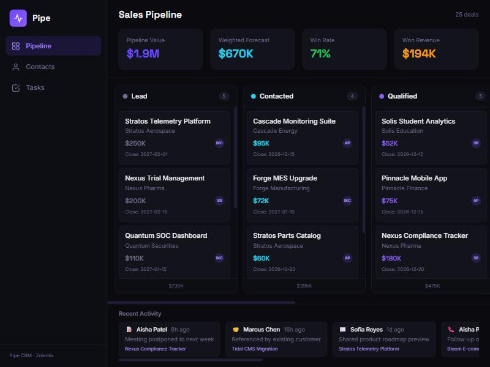

# Pipe — Sales CRM

> Full-featured CRM with drag-and-drop pipeline, contact management, and forecasting, built by [Zolentix](https://zolentix.com)



## Features

- **Kanban Pipeline** — Drag-and-drop deals across 6 stages (Lead to Won/Lost)
- **Pipeline KPIs** — Total value, weighted forecast, win rate, won revenue
- **Contact Management** — Searchable contacts linked to companies and deals
- **Company Directory** — 15+ companies with industry, size, and revenue data
- **Task Manager** — Priority-based tasks with due dates and overdue alerts
- **Activity Feed** — Timeline of calls, emails, meetings, and notes
- **Deal Cards** — Value, owner, company, close date, and probability

## Tech Stack

- **Framework:** Next.js 14 (App Router)
- **Language:** TypeScript
- **Styling:** Tailwind CSS
- **Database:** Prisma ORM + SQLite
- **Drag & Drop:** HTML5 Drag Events
- **Fonts:** Space Grotesk + Inter

## Getting Started

```bash
npm install
npx prisma db push
npx prisma db seed
npm run dev
```

Open [http://localhost:3000](http://localhost:3000) to manage your pipeline.

## License

MIT — [Zolentix](https://zolentix.com)
